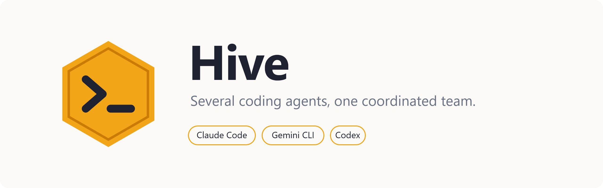

<picture>
  <source media="(prefers-color-scheme: dark)" srcset="docs/images/banner-dark.png">
  <source media="(prefers-color-scheme: light)" srcset="docs/images/banner-light.png">
  
</picture>

<p align="center">
  <br>
  
  &emsp;&emsp;&emsp;
  
  &emsp;&emsp;&emsp;
  
  &emsp;&emsp;&emsp;
  
</p>

# Hive

**Turn several subscription-based coding agents into one coordinated team.**

Hive connects AI coding agents (**Claude Code**, **Codex**, **Antigravity CLI** and
**Gemini CLI**) into one
team, called a **fleet**, that works on one git repository. Each agent is the vendor's
official command-line program (CLI), running on a computer you own and logged in to its own
subscription account. One agent, the **orchestrator**, plans the work and keeps you
informed but never writes code. The others, the **workers**, pick up tasks, lock the files
they edit, and merge their work into the repository's `main` branch once your tests pass.
You stay in charge throughout: you approve the plan, answer the questions only you can
answer, and watch everything live.

New to the terms? The [glossary](docs/GLOSSARY.md) explains every one in plain words.

---

## What it does

- **One shared repository.** Every agent works in its own
  [git worktree](docs/GLOSSARY.md#worktree) (a separate working folder of the same
  repository) on its own branch. Finished work is committed,
  [rebased](docs/GLOSSARY.md#rebase) onto the latest `main`, tested and pushed
  automatically, and every other agent syncs to the new `main`.
- **A task board with automatic assignment.** The orchestrator splits your goal into tasks;
  the server hands each one to an idle agent whose role fits it.
- **File leases.** An agent must lock (lease) every path it edits, so two agents never edit
  the same files at once. [Hooks](docs/GLOSSARY.md#hook), checks Hive runs inside the agent's
  CLI before every action, refuse any other write.
- **A message board.** Channels, direct messages and priorities, up to interrupts that reach
  an agent in the middle of its turn.
- **Roles.** Orchestrator, programmer, planner, reviewer and tester are built in. You can
  change them or add your own.
- **Safe shell access.** Routine commands run directly; dangerous ones (`git push`,
  `rm -rf`, `sudo`, …) need the orchestrator's approval; and commands that would let an agent
  act as you are impossible.
- **Live visibility, for you only.** Follow every agent's output from anywhere with
  `hive watch` in a terminal or the server's web dashboard. Agents never see each other's
  output, only the written reports they file.
- **Mixed fleets.** Windows, macOS and Linux machines, and several accounts per machine. One
  server can host several projects.
- **Cheap to host.** The Hive server is a plain Python web app
  ([WSGI](docs/GLOSSARY.md#wsgi)) with no background processes: it runs on a
  [PythonAnywhere](docs/GLOSSARY.md#pythonanywhere) plan or any small rented Linux server
  ([VPS](docs/GLOSSARY.md#vps)).

### Two rules that always hold

1. **Nobody codes until you approve the plan.**
2. **When an agent is stuck and only you can resolve it, the whole fleet freezes until you
   answer.**

Both are enforced in code, by the server and by hooks, not by asking the AI models nicely.

### No API keys

Hive uses no vendor API keys (the paid, per-request access some vendors sell). It drives the
official CLIs through their documented features: interactive and
[headless](docs/GLOSSARY.md#headless-and-interactive) modes,
[MCP servers](docs/GLOSSARY.md#mcp-mcp-server-mcp-tool) (a standard way to give agents extra
tools), hooks, and plugins/extensions. It never extracts
or proxies account credentials, and each account is used only by its own CLI. Check each
vendor's terms for your own situation, for example how many accounts one person may run.

---

## How it works

<picture>
  <source media="(prefers-color-scheme: dark)" srcset="docs/images/architecture-dark.svg">
  <source media="(prefers-color-scheme: light)" srcset="docs/images/architecture-light.svg">
  
</picture>

- **The server** (`hive server`) is the single source of truth: agents, tasks, messages,
  leases, fleet state, decisions (questions for you), reports, live output, and the web
  dashboard. It runs once, on your computer for a trial or on a web host.
- **A daemon**, a background program started by `hive up`, runs on each computer that hosts
  agents. It asks the server every few seconds whether anything concerns its agents, starts
  them when it does, and runs their git work.
- **The agents** are the unmodified vendor CLIs. Hive attaches its tools, hooks and
  instructions to the sessions it launches, and to no others: a `claude` you open yourself is
  unaffected.

➜ The full picture, a glossary, and the path from a goal to commits on `main`:
[How Hive works](docs/ARCHITECTURE.md).

---

## Quick start

A trial on one computer, with one orchestrator and one programmer. You need Hive
([installation](docs/INSTALLATION.md)), git, a repository you can push to, and Claude Code
with two accounts. `~/code/myapp` stands for your repository's folder.

```sh
hive server                          # 1. a local server (keep this terminal open; it logs you in)

cd ~/code/myapp                      # 2. in another terminal, in your repository
hive init
git add hive.toml .hive .gitignore && git commit -m "Set up Hive" && git push

hive agents add claude               # 3. the orchestrator (the first agent plans)
hive agents add claude programmer    #    and a programmer; each offers to log its account in

hive up                              # 4. runs the agents (the orchestrator opens here)
hive                                 # 5. in another terminal: the chat with the team.
                                     #    Type the goal; approve the plan with y.
```

`hive` on its own always knows what's next: until the team is set up it shows the one next
step, then it is the chat. The same works as single commands
(`hive start "…"`, `hive approve`), and the chat's slash commands are those commands.
`hive help` lists the common commands, and `hive help TOPIC` explains any of them, or a
subject such as `hive help hooks`, in detail (`hive help topics` lists them). Every older,
more precise command still works (`hive help --all`).

➜ Step by step, with what each step does: [Getting started](docs/GETTING_STARTED.md).
The design of this interface: [CLI_REDESIGN.md](docs/CLI_REDESIGN.md).

---

## Documentation

### Getting started

| Guide | What it covers |
|---|---|
| [Getting started](docs/GETTING_STARTED.md) | A first fleet on one computer, from installing to approving the first plan, with what each step does. |
| [How Hive works](docs/ARCHITECTURE.md) | The server, daemons and agents; how a goal becomes commits on `main`; how rules are enforced. |
| [Glossary](docs/GLOSSARY.md) | Every term in plain words, and the example names used in these docs. |
| [Requirements and installation](docs/INSTALLATION.md) | What each machine needs, the installer scripts and their options, and why `hive` must be on PATH. |

### Setting up

| Guide | What it covers |
|---|---|
| [Running the server](docs/SERVER.md) | The admin token and database, running locally, and logging in as admin. |
| [Deploying the server](docs/DEPLOYMENT.md) | Hosting on PythonAnywhere or a VPS: capacity planning with measured numbers, upgrades, backups, monitoring and hardening. |
| [Several projects on one server](docs/PROJECTS.md) | Hosting several repositories and fleets on one server, each with its own database and admin token. |
| [Preparing the repository](docs/REPOSITORY.md) | What `hive init` creates and why it doesn't affect your own CLI sessions; checking everything with `hive doctor`. |
| [Enrolling agents and setting up machines](docs/MACHINES.md) | Creating agents, adding them to computers as *slots* (an agent's own working folder and account), and logging their accounts in. |

### Running a fleet

| Guide | What it covers |
|---|---|
| [Running the fleet](docs/RUNNING.md) | `hive up` on the orchestrator's computer and on workers' computers; how a worker is started for a piece of work; taking over an agent with `hive chat`. |
| [Working with the orchestrator](docs/ORCHESTRATOR.md) | Chatting with it, answering its decisions, its status updates, and what it can and can't do. |
| [Watching the fleet](docs/MONITORING.md) | Live output with `hive watch`, and the web dashboard: every panel, filters, and archives of past runs. |
| [The fleet lifecycle](docs/LIFECYCLE.md) | Fleet states from `setup` to `running`: plan approval, freezing on stuck agents, pausing and resetting. |

### How the fleet coordinates

| Guide | What it covers |
|---|---|
| [Roles](docs/ROLES.md) | The built-in roles, custom roles and overrides in `hive.toml`, standby orchestrators, and how roles are enforced. |
| [Tasks, messages and reports](docs/COORDINATION.md) | The task board and scheduler, channels and message priorities, and how workers report to the orchestrator. |
| [Leases, git integration and reviews](docs/INTEGRATION.md) | File leases, worktrees and branches, every step of getting work into `main`, GitHub mode, and reviews. |

### Agents and safety

| Guide | What it covers |
|---|---|
| [What the agents see](docs/AGENT_INTERFACE.md) | The tools each role gets, the hooks that deliver messages and enforce leases, and the written procedures (skills) agents follow. |
| [Shell-command permissions](docs/PERMISSIONS.md) | The three command tiers (allowed, approved by the orchestrator, never), how approvals work, and how to customise them. |
| [Customising what agents are told](docs/PROMPTS.md) | Adding your project's conventions to the agents' instructions with `.hive/prompts/`, placeholders, and previewing the result. |
| [Security model](docs/SECURITY.md) | Tokens and what each can do, who sees what, secrets in output, prompt injection, and a checklist. |

### Reference

| Reference | What it covers |
|---|---|
| [The `hive` command](docs/CLI.md) | Every command with examples, common recipes, error messages, and a one-table command summary. |
| [Configuration reference](docs/CONFIGURATION.md) | `hive.toml`, `machine.toml`, environment variables, file locations, timings and limits. |
| [Troubleshooting](docs/TROUBLESHOOTING.md) | Symptoms and fixes, grouped by starting, tools, integration and vendor CLIs. |
| [Known limitations](docs/LIMITATIONS.md) | What has been verified against which CLI versions, what hasn't yet, and current limitations. |
| [Development](docs/DEVELOPMENT.md) | Running the tests, the source layout, and the design and audit documents. |
| [Specification](SPEC.md) | The design rationale and full specification. |

---

## Status

Hive is under active development. The server, daemon, leases, git integration and dashboard
are covered by automated unit and end-to-end tests, and Codex support is tested end to end against the
real CLI. Some integration points haven't yet been exercised with live, logged-in accounts;
[Known limitations](docs/LIMITATIONS.md) lists them.

---

## Contributing

Contributions are welcome. If something doesn't work as described, or you have an idea,
please [open an issue](https://github.com/themostvexingparse/hive/issues): include what you
ran, what you expected, and what happened instead (`hive doctor` output helps). Pull
requests are welcome too; [Development](docs/DEVELOPMENT.md) explains how to run the tests
and where things live in the source.
