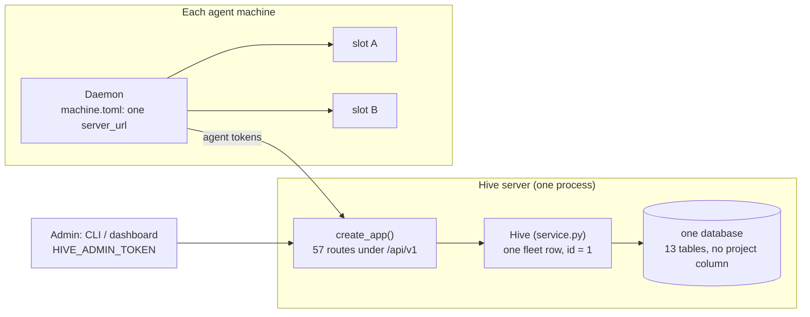
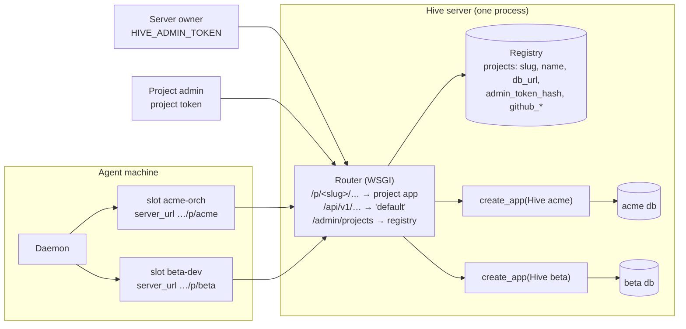

# Multi-project audit

**Date:** 2026-10-20
**Scope:** `master` at `559e3ca`: server (`src/hive/server/**`), daemon (`src/hive/daemon/**`),
CLI and config (`cli.py`, `config.py`, `overview.py`), the dashboard and `SPEC.md`.
**Question:** what has to change for one Hive server to run several projects (repositories,
each with its own fleet) at the same time?
**Status:** **implemented** on 2026-10-20 as option A (see [§7 Resolution](#7-resolution)).
The S12 bug was fixed first.

**Answer in short:** the server is single-project throughout. There is one `fleet` row, no
project column in any table, and one admin token. The cheapest safe design keeps
`service.py` as it is and runs **one `Hive` instance per project behind a URL prefix**
(`/p/<project>/api/v1/...`), each with its own database or SQLite file. A small project registry
and a request router sit in front of them. On the client side, the server URL moves from the
machine to each slot. That's roughly **6–9 working days**, against **15–20** for adding a
`project_id` to every table.

---

## 1. How it works today

Every request reads or locks the single fleet row. It holds the state machine, the config
(`hive.toml`), the orchestrator, the fencing counter, `main`'s sha and the goal. Every
other row (agent, task, lease, message, decision and so on) implicitly belongs to that one fleet.

---

## 2. Where the single-project assumption lives

Severity is about multi-project support only: **Blocker** = can't work without changing this;
**Major** = works but breaks isolation or correctness; **Minor** = cosmetic or operational.

| # | Area | Location | Assumption | Severity |
|---|---|---|---|---|
| S1 | Fleet state | `server/db.py:96`, `service.py:101-103`, `:122-126`, `:171-174` | Exactly one `fleet` row, `id == 1`. It is read or locked at 79 call sites. | Blocker |
| S2 | Data model | `server/db.py:17-192` | None of the 13 tables has a project column. Tasks, leases, messages, events, decisions and so on are global. | Blocker |
| S3 | Agent identity | `db.py:19`, `service.py:32-33`, `:178-186` | Agent `name` is the global primary key. A token resolves to an agent with no project. | Blocker |
| S4 | Admin auth | `app.py:20-22`, `:48-63` | One `HIVE_ADMIN_TOKEN` controls everything. There is no per-project administrator. | Blocker |
| S5 | Config | `service.py:188-210`, `cli.py:128-133` | `PUT /config` replaces *the* config. The roles catalog, permissions, review mode and `repo.main` are server-wide. | Blocker |
| S6 | Git integration | `service.py:765-778`, `app.py:25` | One `HIVE_GITHUB_TOKEN` for every repository. `repo.github`/`repo.main` come from the single config. | Major |
| S7 | Lazy scheduler | `app.py:44-46`, `service.py:1302-1355` | `before_request` runs `tick()` for the one fleet: lease expiry, offline detection, failover and scheduling. | Major |
| S8 | Archives | `archives.py:92-100`, `service.py:1406-1470` | One archive folder. A flush empties *all* tables and resets *the* fleet. Two SQLite files in one folder would share `hive-archives/`. | Major |
| S9 | Backups | `app.py:425`, `service.py:1357` | `/admin/backup` copies the whole database. A project admin would get every project's data. | Major |
| S10 | Dashboard | `dashboard.html:865`, `:1517`, `:721-725` | Calls the absolute path `/api/v1`. Stores the token in `localStorage` under one key for the whole origin. | Major |
| S11 | Machine config | `config.py:67-68`, `core.py:155` | One `server_url` per machine; every slot talks to it. | Major |
| S12 | `hive join` | `cli.py:246-247` | `--server` overwrites the **machine-wide** URL, silently repointing every existing slot. This is already a bug today. | Major |
| S13 | Admin CLI | `config.py:114-138`, `cli.py:28-32` | `admin.toml` holds one server URL and one token. `start`, `decide`, `say`, `status` and `push-config` act on "the" fleet. | Major |
| S14 | Local slot keys | `daemon/store.py:14-24`, `cli.py:273`, `localapi.py:39` | Slots are keyed by agent name in `state.db`, `~/.hive/accounts/NAME`, `HIVE_SLOT` and `/slot/<name>/hook`. If two projects use the same agent name on one machine, they collide. | Major |
| S15 | Event cursor | `store.py:41`, `core.py:219-229` | A slot's event cursor survives re-joining. Pointed at another project's sequence, it skips or replays events. | Minor |
| S16 | Schema changes | `db.py:256` | `metadata.create_all` only creates missing tables; it never adds columns. There is no migration tool, so any schema change breaks existing databases. | Blocker for option B |
| S17 | Overview / docs | `overview.py:239-300`, `SPEC.md` §1, §4, §16, §18 | They describe "the fleet" and compare one machine URL against one admin URL. | Minor |

What is **not** affected:
- **Agent-side tools.** The MCP server, hooks, permissions, `wake.py` and `gitops.py` talk only
  to the local daemon or to git, so they are already project-agnostic.
- **The daemon's per-slot runtime.** It already handles one repository per slot.
  `SlotRuntime.repo_root` and `repo_cfg` are found per worktree (`core.py:97-105`).
- **The client's URL building.** `ServerClient` appends `/api/v1` to whatever base URL it's
  given (`client.py:18`), so a project-scoped base URL works without any change.

---

## 3. Design options

| | **A. One instance per project** (recommended) | **B. Shared tables + `project_id`** | **C. One server per project** (today's workaround) |
|---|---|---|---|
| How | A router maps `/p/<slug>/…` to its own `Hive` and its own database or SQLite file. A registry lists the projects. | Add `project_id` to all 13 tables and scope every query. The fleet row becomes per project. | Deploy N copies of the server (N web apps or N ports). |
| Changes to `service.py` | Almost none: auth only. | All 115 queries and 79 fleet call sites. | None. |
| Isolation | By construction: a project can't read another project's rows. | Only as good as every `WHERE` clause. A missed filter means one project can read another's data by guessing ids. | Complete. |
| Concurrency | Each project has its own write lock and database, so projects don't block each other. | SQLite: one lock for every project. MySQL/Postgres: per-row locks are fine. | Complete. |
| Migration | The existing database becomes project `default` unchanged. | Needs a migration tool (S16) plus a backfill. | None. |
| Backups, archives, flush | Per project, for free. | Every operation must be scoped and re-tested. | Per server. |
| Cost | N database connections or pools, lazily opened. Connection limits apply. | One pool. | N deployments. On PythonAnywhere that's N web apps or domains. |
| Shared agent across projects | One enrollment per project (one token per project). | Possible later. | One enrollment per server. |
| Estimate | **6–9 days** | **15–20 days** | 0 days, but not "one server" |

**Why A:** it turns a cross-cutting rewrite into a thin layer around code that already works.
It also keeps all 234 tests meaningful, because they build `create_app(hive, admin_token)`
directly. Option B is only worth it if you later want cross-project features, such as one
agent serving several projects in a single session, or fleet-wide queries over all projects.
Option A can be migrated to B later; going from B to A would be much harder.

---

## 4. Recommended architecture (option A)

### 4.1 Project identity is the URL

A project's server URL is `https://host/p/<slug>`. That single choice is what keeps the client
changes small:
- `hive.toml`'s `[server] url` is already per repository, so the repo itself names its project.
- `ServerClient` already appends `/api/v1`, so daemons, the MCP server and the admin CLI need no
  routing logic.
- Agent tokens only have to be valid in their own project's database.

Slugs follow the agent-name rule: `^[a-z][a-z0-9-]{1,31}$`.

### 4.2 Server components

1. **Registry** (`server/projects.py`, new):
   - **Storage:** one small table in the server's main database, holding `slug`, `name`,
     `db_url`, `admin_token_hash`, `github_repo`, `github_token_ref`, `created` and `archived`.
   - **Owner API:** under `/api/v1/admin/projects`, usable with the owner token only. It covers
     create, list, rotate the project admin token and archive.
   - **Creating a project:** provisions the database. For SQLite that's
     `<data dir>/projects/<slug>/hive.db`; for MySQL/Postgres, see §6, Q1.
2. **Router** (`server/router.py`, new; `wsgi.py` and `cmd_server` use it):
   - **Routing:** a WSGI dispatcher matches `/p/<slug>`, moves the prefix into `SCRIPT_NAME`,
     and hands the request to that project's Flask app.
   - **Lazy loading:** apps are built on first use and cached.
   - **Eviction:** idle projects are evicted with `engine.dispose()`, so N projects don't hold
     N connection pools forever.
   - **Compatibility:** an un-prefixed `/api/v1/...` goes to project `default`, so existing
     daemons keep working.
3. **Auth** (`app.py` `auth()`): accept either the owner token or that project's admin token
   (compare hashes). Agent tokens are unchanged; each one only exists in its own project's
   database.
4. **Per-project paths:** archives and backups go under the project's own folder (S8, S9).
   `/admin/backup` then returns only that project's database.
5. **GitHub credentials** (S6):
   - Each project gets its own token, ideally a fine-grained PAT limited to that repository.
   - Store it as a reference (`env:HIVE_GITHUB_TOKEN_ACME`), or encrypted with a server key
     (`HIVE_SECRET_KEY`).
   - Never return it from the API.
6. **Scheduler** (S7): `tick()` stays per instance and runs only on requests to that project.
   - Active projects get requests every few seconds from daemon heartbeats.
   - An idle project's lease expiry or failover is evaluated on its next request. That's the
     same lazy model as today, so no background worker is needed (PythonAnywhere still works).

### 4.3 Client changes

| Component | Change |
|---|---|
| `Slot` / `MachineConfig` (S11) | Add `Slot.server_url`. `MachineConfig.server_url` stays as the default for old configs. `SlotRuntime(s, s.server_url or mcfg.server_url)` (`core.py:155`). |
| `hive join` (S12, S15) | Write `--server` onto the slot, never the machine. Reset the slot's event cursor and inbox in `state.db` when its server URL changes. |
| Slot names (S14) | **Phase 1:** `hive join` refuses a name already used on this machine, with a clear message. **Phase 2:** local slot ids qualified by project, e.g. `acme.orch`, for `state.db`, `accounts/`, `HIVE_SLOT` and the local API path. |
| `admin.toml` (S13) | Store tokens per server URL: `[servers."https://host/p/acme"] token = …`. Admin commands use the repo's `hive.toml` `[server] url` when run inside a repo, else `--server`/`--project`. Add `hive admin project create/list/rotate`. |
| `hive init` | `--project <slug>` writes `https://host/p/<slug>` into `hive.toml`. |
| Dashboard (S10) | Call the API relative to the page's own prefix (`location.pathname` up to `/p/<slug>/`). Store the token per project key, and prefer `sessionStorage`. Add a project switcher on the owner view. |
| `hive overview` (S17) | Check each slot's URL against its own repo's `hive.toml`, instead of comparing one machine URL with one admin URL. |

### 4.4 Security notes

- **Shared browser origin.** All projects on one host share an origin, so one project's
  dashboard can read tokens another project's page saved in `localStorage`. The dashboard
  escapes all output, but per-project storage keys with `sessionStorage` reduce the damage of
  any future cross-site scripting (XSS) bug. A subdomain per project removes the sharing
  completely.
- **Two levels of admin.** The owner token can create and delete projects. A project admin token
  can do everything today's admin can, but only inside its own project. Keep `hive admin`
  commands working with either token.
- **Log the router's decisions** (slug resolved, unknown slug → 404 without revealing whether
  the project exists).

---

## 5. Implementation plan

| Phase | Work | Estimate |
|---|---|---|
| 1. Server core | Registry table and owner API; router with lazy loading and eviction; per-project database, archive and backup paths; two-level auth; `default` project for un-prefixed URLs. | 3–4 days |
| 2. Clients | `Slot.server_url`; fixes to `join` (S12, S15); duplicate-name guard; `admin.toml` per server; `hive admin project …`; `hive init --project`. | 2–3 days |
| 3. Dashboard and docs | Relative API base, per-project token storage, project switcher; `SPEC.md` §3, §4, §16, §18; `DEPLOYMENT.md` (MySQL setup per project). | 1–2 days |
| 4. Tests | Router isolation (project A's token on project B gets 401; an id from A isn't readable from B); end-to-end with two projects on one server and one machine; upgrading an existing database to `default`. | included above, ~1 day |

The S12 and S15 fixes are worth doing now whatever is decided, because `hive join --server`
already repoints every slot on the machine today.

---

## 6. Open questions

1. **Databases on MySQL and PythonAnywhere.**
   - Option A needs one database per project. PythonAnywhere creates MySQL databases from its
     *Databases* tab, so creating a project there may need a manual step. This hasn't been
     verified.
   - The fallback is per-project table prefixes in one database: `MetaData` built per project,
     with `service.py` reading tables from the instance instead of module globals. That's a
     mechanical change across the 115 queries, about +2 days.
   - Postgres can use one schema per project via `schema_translate_map`.
2. **Connection limits.** Each cached project holds its own pool (SQLAlchemy defaults to 5 + 10
   overflow). Use a small `pool_size` or `NullPool` for project engines, and check the host's
   per-user connection limit.
3. **One agent account in several projects.** With option A, that agent is enrolled once per
   project and gets one slot per project on its machine. Is that acceptable, or is a single
   session working across projects a requirement? If it is, option B becomes necessary.
4. **Who creates projects?** Only the server owner (assumed here), or self-service?
5. **Agents' unscoped task numbers.** Today task `#12` is unique per server. Under option A it
   becomes unique per project, so messages that mention `#12` stay unambiguous only within a
   project. That's fine as long as agents never see other projects.

---

## 7. Resolution

Implemented on 2026-10-20 as option A. The test suite grew from 234 to 240 tests (all
passing, 4 skipped as before): `tests/test_join.py` and `tests/test_projects.py` are new.

| Finding | Resolution |
|---|---|
| S12, S15 | **Fixed first.** `Slot.server_url` holds each slot's server. `hive join --server` sets only that slot's; the first join also sets the machine's default. A slot moved to another server has its local state reset (`Store.forget`). |
| S14 | `hive join` refuses a slot name that already exists for another server or project, unless `--replace` is given. This is the phase-1 guard from §4.3; project-qualified local slot ids weren't needed. |
| S1–S5, S7 | `server/router.py` serves `/p/<slug>/…` from a per-project `Hive` with its own database. `server/projects.py` is the registry, kept in the default database. Project admin tokens are stored hashed; only the server's admin token manages projects. `service.py` is unchanged. |
| S6 | Per-project `github_token_env`; `HIVE_GITHUB_TOKEN` applies to the default project only. |
| S8, S9 | Each project's archives go in `projects/<slug>/hive-archives/`; `/admin/backup` copies that project's database. |
| S10 | The dashboard calls the API under its own address and keeps tokens per project. The server's admin gets a project switcher in the ⋯ menu. |
| S11, S13 | `MachineConfig.url_for(slot)`; `admin.toml` `[servers]`; `--project` / `HIVE_PROJECT`; a repository whose `hive.toml` names a project targets it; `hive admin project create/list/set/rotate`. |
| S16 | Not needed: option A adds a table and alters none. |
| S17 | `hive overview` checks each slot's own URL and the admin target for the repository. README §4.4, SPEC §22 and DEPLOYMENT §15 describe the feature. |

**Open questions, as decided:**
- **Q1 (MySQL):** one database per project. Either `--db-url`, or `HIVE_PROJECT_DATABASE_URL`
  with `{slug}`, so you only create the database (on PythonAnywhere, on the *Databases* tab).
  A database that can't be opened leaves no project behind.
  - **Not done:** the table-prefix fallback.
  - **Not verified:** creating databases on PythonAnywhere itself.
- **Q2 (connections):** project pools are 2 + 4 connections, closed after 10 idle minutes.
- **Q3 (one agent in several projects):** one enrollment per project.
- **Q4 (who creates projects):** the server's admin only.

